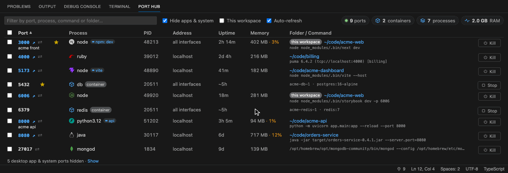
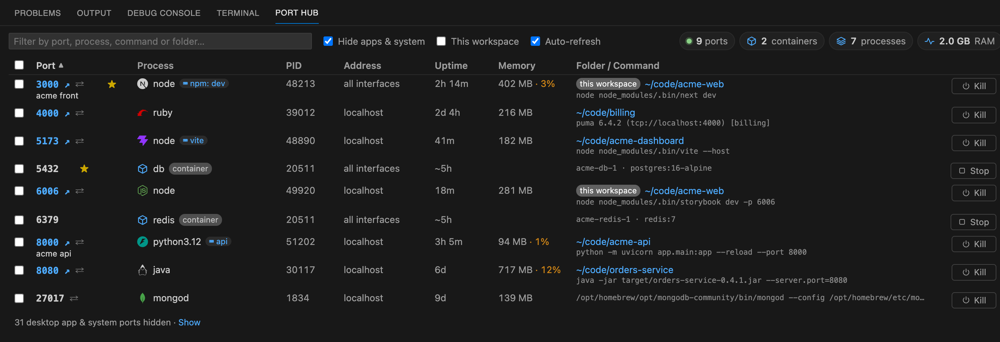

# Port Hub: Kill Process on Port in VS Code

**See what is using a port, which project started it, and kill it in one click, right next to your terminal.** A port manager for VS Code, Cursor and other VS Code-based editors, on macOS, Linux and Windows.



When you run several dev servers, databases and tools at once, sooner or later you hit `EADDRINUSE: address already in use :::3000` (or "Port 3000 is already in use") and have no idea what is on port 3000. Port Hub adds a **Port Hub** tab to the bottom panel (next to Terminal, Problems and Output) that lists every listening TCP port on localhost with:

- the **process** and **PID**
- the **folder it was started from**, so you can tell *which project* is holding the port (rows from the open workspace get a `this workspace` badge)
- the full **command line** (click it to copy)
- **uptime**, **memory** and **CPU** (when busy) of the process
- the **VS Code terminal** it was started from (click to jump there)
- a link to **open it in the browser** when it's a web server
- a **Kill** button (Shift+click to force kill), or **Stop** for Docker containers

No more `lsof -i :3000`, `netstat -ano | findstr :3000` or `npx kill-port 3000`. It works on **macOS, Linux and Windows**, and in remote windows (WSL, SSH, Dev Containers, Codespaces).

---

## VS Code extension

### "Port already in use" in the terminal

When a command in the VS Code terminal fails because its port is taken, Port Hub pops up:

> Port 3000 is already in use by node (pid 4121) in ~/code/other-app. **[Kill & Run Again] [Kill] [Show]**

**Kill & Run Again** frees the port and re-runs your command in the same terminal. It recognises Node (`EADDRINUSE`), Vite and Next ("Port 3000 is in use, trying 3001"), Go, Python/uvicorn, Rails/Puma, PHP, Spring Boot, Create React App and Docker. When the error doesn't say which port (Python), the port is read from the command (`python -m http.server 8000`, `--port 8001`, `PORT=4000`…).

This needs VS Code 1.93+ and terminal shell integration (on by default). Turn it off with `porthub.detectPortConflicts`.

### Free the port before debugging

Add a `porthub` task and use it as `preLaunchTask`, so **F5 never fails with "port already in use"**:

```jsonc
// .vscode/tasks.json
{ "version": "2.0.0", "tasks": [{ "label": "Free port 3000", "type": "porthub", "ports": [3000] }] }

// .vscode/launch.json, in your configuration:
"preLaunchTask": "Free port 3000"
```

Ports you've labeled also show up in **Terminal → Run Task → porthub**.

### Stop this workspace's servers

`Port Hub: Stop Servers Started in This Workspace` (also in the panel's `…` menu) stops every server started from the open folder, after one confirmation. Turn on `porthub.stopServersOnClose` to do it automatically when the window closes, so nothing is left holding your ports (Docker containers are left running on close).

### Move a server to another port

Running something on 3000 and need 3000 for something else? Click **⇄** on its row (or `Port Hub: Move Server to Another Port…`), pick the new port (the nearest free one is suggested) and confirm the command. A process can't change its port while running, so Port Hub **restarts it**:

- It works out the new command: changes the port if it's written in the command (`--port 3000`, `-p 3000`, `PORT=3000`, `:3000`), otherwise adds the right option for the tool (Vite, Next, Nuxt, Astro, Angular, webpack, Remix, Storybook, Gatsby, uvicorn, Flask, Django, Rails, Laravel, Symfony, Hugo…, with `--` for `npm run`), otherwise sets `PORT=3001`. **You see the command and can edit it before it runs.**
- If the server runs in a VS Code terminal, it's stopped with Ctrl+C and restarted in the same terminal; otherwise it's restarted in a new terminal in its folder.
- Your label and ★ watch move to the new port, and you get **Open** when it's up.

When a command of yours fails because its port is taken, the prompt also offers **Use 3001**: run *your* command on a free port and leave the other server alone.

Docker containers can't be moved this way (their ports are fixed when created): change the mapping in your compose file.

### Two programs on one port (IPv4 + IPv6)

The OS lets one program listen on port 3000 over **IPv4** and another over **IPv6** at the same time, so neither gets "port already in use". But then `http://localhost:3000` (IPv6 is tried first) and `http://127.0.0.1:3000` open **different apps**. Port Hub marks both rows **⚠ shared**, labels them `IPv4` / `IPv6`, says which one `localhost` reaches, makes each row's ↗ link open the right address, and warns once with **Move one…** (`porthub.warnSharedPorts`).

### Watched ports

Click **☆** on a port (or set `porthub.watchPorts`, e.g. `[3000, 5432]`) to watch it. Watched ports stay in the panel as "not listening" when they're down, the status bar turns into a warning (`⚠ 5432 down`), and you get a notification when one stops or starts, with **Open** for web servers.

### Docker containers

Ports published by Docker Desktop, OrbStack or Podman show the **container** (compose service, image, project folder) instead of `com.docker.backend`. Its button says **Stop** and runs `docker stop` on just that container (Shift+click for `docker kill`). Port Hub never kills Docker itself, since that would stop every container.

### Using it




- Open the **Port Hub** tab in the bottom panel, or click the `🔌 7` item in the status bar.
- **Hide apps & system** (on by default) hides ports held by desktop apps (Discord, Chrome, VS Code's own helpers…), OS services and editor/agent helpers like Claude Code, based on where the program is installed, not guesswork. Docker containers, and dev servers installed as apps (Postgres.app, Herd, Ollama), stay visible. On a typical Mac this takes the list from ~45 ports to ~15.
- **This workspace** shows only servers started from the folder open in this window.
- The note under the table says what's hidden, with **Show** to bring it back. The Address column shows `localhost` or `all interfaces` for every port.
- Type in the filter box to match a port, process name, command, folder, container or label. `:3000` matches exactly port 3000.
- Ports that answer HTTP show as a link (`5173 ↗`): click to open it in your browser, or in VS Code's Simple Browser (`porthub.openBrowserIn`).
- Started from a VS Code terminal? Click the **⌨ terminal** badge to jump to it. The "port in use" prompt offers **Go to Terminal** too.
- Click **Kill**. You will be asked to confirm, and you can choose **Kill** (graceful) or **Force Kill**.
- Click any column header to sort; click again to reverse. **Uptime** and **Memory** start with the oldest / biggest first, which is handy for spotting forgotten dev servers.
- Tick several rows (or the header box to select everything visible), then **Kill N selected**. Tip: filter by a project name first, then select all.
- Hover a port and click **✎** to give it your own name ("rezicard front"). Names are shown under the port, searchable in the filter, and stored in the `porthub.portLabels` setting.
- The ⚙ button in the panel's title bar opens Port Hub's settings.
- Command palette: `Port Hub: Kill Process on Port…` lets you pick from a list or type a port number. `Port Hub: Refresh` reloads the list.

Port Hub will not let you kill VS Code itself; those rows are marked `VS Code` and their Kill button is disabled.

### Settings

| Setting | Default | What it does |
| --- | --- | --- |
| `porthub.hideAppsAndSystem` | `true` | Hide desktop apps, OS services and editor/agent helpers |
| `porthub.workspaceOnly` | `false` | Only show servers started from this workspace |
| `porthub.hideSystemPorts` | `false` | Hide ports below 1024 |
| `porthub.portRange` | `""` | Only show e.g. `3000-9999` or `3000-3999,5432,8080` |
| `porthub.autoRefreshInterval` | `5` | Seconds between refreshes (0 = off). Only runs while the window is focused |
| `porthub.confirmBeforeKill` | `true` | Ask before killing |
| `porthub.portLabels` | `{}` | Your names for ports, e.g. `{ "3000": "rezicard front" }` |
| `porthub.watchPorts` | `[]` | Ports you expect to be running; warns when one is down |
| `porthub.notifyWatchedPorts` | `true` | Notify when a watched port stops or starts |
| `porthub.openBrowserIn` | `external` | Open web servers in your browser or in VS Code's Simple Browser |
| `porthub.stopServersOnClose` | `false` | Stop this workspace's servers when the window closes |
| `porthub.warnSharedPorts` | `true` | Warn when two programs share a port (one on IPv4, one on IPv6) |
| `porthub.detectPortConflicts` | `true` | Offer to free the port when a terminal command fails with "port in use" |
| `porthub.showStatusBar` | `true` | Show the port count in the status bar |

---

## FAQ

**How do I find out what is using port 3000 in VS Code?**
Open the **Port Hub** tab in the bottom panel (or click `🔌` in the status bar) and type `:3000` in the filter. You see the process, PID, its project folder and the full command.

**How do I kill the process on a port?**
Click **Kill** on its row, or run `Port Hub: Kill Process on Port…` from the command palette and type the port number. Shift+click forces it (`SIGKILL` / `taskkill /F`).

**How do I fix "EADDRINUSE: address already in use"?**
When a command in the VS Code terminal fails with it, Port Hub offers **Kill & Run Again** (free the port and re-run your command) or **Use 3001** (run yours on a free port instead).

**Does it work with Docker?**
Yes. Ports published by Docker Desktop, OrbStack or Podman show the container and compose service, and **Stop** runs `docker stop` on that container only.

**Does it work in Cursor, Windsurf or VSCodium?**
Yes, it works in any editor based on VS Code 1.90 or newer.

---

## How it works

| OS | Listening ports | Command line | Folder |
| --- | --- | --- | --- |
| macOS | `lsof -iTCP -sTCP:LISTEN` | `ps` | `lsof -d cwd` |
| Linux | `lsof`, else `ss -ltnp`, else `/proc/net/tcp` | `ps`, else `/proc` | `/proc/<pid>/cwd` |
| Windows | `netstat -ano` + `tasklist` | PowerShell `Win32_Process` | not available |

**Remote windows** (WSL, Remote SSH, Dev Containers, Codespaces): Port Hub runs where your workspace runs, so it shows the ports on that machine or container; the panel says where (`· Dev Container`). It works even in minimal containers without `lsof`, `ss` or `ps`, by reading `/proc`.

Without admin rights, the OS only shows the owner of ports opened by **your own user**. Ports owned by root or other users appear with PID `?` and cannot be killed from here.

---

## Development

```sh
npm install
npm run build             # bundles the extension
npm test                  # unit tests + real-system tests (starts a server, finds it, kills it)
npm run test:integration  # runs the extension inside a real VS Code (downloads one; or set VSCODE_EXECUTABLE_PATH)
npm run typecheck
npm run package           # produces packages/vscode/porthub-<version>.vsix
```

- **Run the extension:** open this folder in VS Code and press **F5**.
- **CI:** `.github/workflows/ci.yml` runs everything on macOS, Linux and Windows, against the latest VS Code and the oldest supported one (1.90).
- **Releasing:** see `RELEASING.md` in the repository.

```
packages/
  core/    shared port listing + kill logic (no VS Code dependency)
  vscode/  the extension (panel webview, commands, status bar, terminal watcher)
```
